## Stats
<picture>
  <source media="(prefers-color-scheme: dark)" srcset="https://raw.githubusercontent.com/ba230t/ba230t/output/github-contribution-grid-snake-dark.svg">
  <source media="(prefers-color-scheme: light)" srcset="https://raw.githubusercontent.com/ba230t/ba230t/output/github-contribution-grid-snake.svg">
  
</picture>

  
  

<!-- Bing Wallpaper Start -->
## 氷がつなぐ未来

[ホッキョクグマの親子、ハドソン湾、マニトバ州、カナダ (© Danita Delimont/Adobe Stock)](https://www.bing.com/search?q=%E3%83%9B%E3%83%83%E3%82%AD%E3%83%A7%E3%82%AF%E3%82%B0%E3%83%9E%E9%80%B1%E9%96%93&form=hpcapt&filters=HpDate%3a%2220261101_1500%22)
<!-- Bing Wallpaper End -->
