## Stats
<picture>
  <source media="(prefers-color-scheme: dark)" srcset="https://raw.githubusercontent.com/ba230t/ba230t/output/github-contribution-grid-snake-dark.svg">
  <source media="(prefers-color-scheme: light)" srcset="https://raw.githubusercontent.com/ba230t/ba230t/output/github-contribution-grid-snake.svg">
  
</picture>

  
  

<!-- Bing Wallpaper Start -->
## 灰色と黄金色が織りなす風景

[夕暮れの岩山、フェイス・キャニオン、パウエル湖、ユタ州、アメリカ (© Jeff Foott/Minden)](https://www.bing.com/search?q=%E3%83%91%E3%82%A6%E3%82%A8%E3%83%AB%E6%B9%96&form=hpcapt&filters=HpDate%3a%2220261126_1500%22)
<!-- Bing Wallpaper End -->
